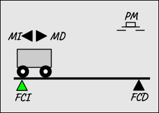

# :fontawesome-solid-cart-shopping: Carro Básico

## :fontawesome-solid-file-lines: Descripción

El proyecto **Carro Básico** es una adaptación del clásico problema de automatización conocido como **«el carro va y viene»**, que consiste en un móvil que se desplaza longitudinalmente entre los dos extremos (izquierdo y derecho) de un tramo de vía.

{ width="300px" .image-centered }
<figcaption>Figura 1: Representación Esquemática.</figcaption>

### Parte Operativa

- Un **motor** con dos señales de mando para controlar su movimiento: **marcha derecha** y **marcha izquierda**.
- Un par de sensores: **final de carrera izquierdo** y **final de carrera derecho**.

### Parte de Relación

Consiste en un panel de operador básico compuesto únicamente por:

- Un **pulsador de marcha**, para iniciar el funcionamiento.
- Una **lámpara de marcha**, para indicar el estado del sistema.

## :fontawesome-solid-gear: Descripción Funcional

El funcionamiento básico del carro es como sigue.

1. El carro se pone en marcha hacia la derecha cuando se acciona el pulsador de marcha.
2. Cuando el carro alcanza el final de carrera derecho, invierte el sentido de la marcha.
3. El carro se detiene al alcanzar, de nuevo, el final de carrera izquierdo.

**Condición inicial**: carro detenido sobre el final de carrera izquierdo.

## :fontawesome-solid-layer-group: Modalidades

El proyecto contempla diferentes variantes de complejidad progresiva.

1. **Carro Pulsado**. El carro inicia un viaje de ida y vuelta únicamente cuando, estando en su posición inicial, se acciona el pulsador de marcha.
2. **Carro Temporizado**. El carro se detiene durante un tiempo determinado ($T_{espera}$) sobre el final de carrera derecho antes de iniciar el regreso a su posición inicial.
3. **Carro Limitado**. El carro realiza un número determinado de viajes consecutivos de ida y vuelta (tarea) cada vez que, estando en su posición inicial, se acciona el pulsador de marcha.
4. **Carro Señalizado**. La lámpara de marcha permanece encendida mientras el carro está en funcionamiento y parpadea cuando está en reposo.

## :fontawesome-solid-arrows-left-right: Entradas y Salidas

| Nombre | Tipo | Origen | Descripción |
| :---: | :---: | :---: | :--- |
| `PM` | `Binario` | Entrada | Pulsador de Marcha |
| `FCI` | `Binario` | Entrada | Final de carrera izquierdo |
| `FCD` | `Binario` | Entrada | Final de carrera derecho |
| `LM` | `Binario` | Salida | Lámpara de Marcha |
| `MI` | `Binario` | Salida | Marcha Izquierda |
| `MD` | `Binario` | Salida | Marcha Derecha |

---

## :fontawesome-solid-brain: Especificación Funcional

Las siguientes especificaciones funcionales describen con precisión el comportamiento del carro (lógica de control) mediante **Diagramas de Relés y Contactos** y el lenguaje **GRAFCET**.

- [Diagrama de relés y contactos (PDF)](./pdf/carro_basico_drc.pdf).
- [Diagrama GRAFCET (PDF)](./pdf/carro_basico_grf.pdf).

---

## :fontawesome-solid-folder-tree: Estructura Simplificada del Repositorio

```text
TC3_Carro_Basico/
├── docs/
│   └── diagrams/
│       ├── Carro_Basico_DRC.pdf <-- Diagrama de Relés y Contactos (PDF)
│       └── Carro_Basico_GRF.pdf <-- Diagrama Grafcet (PDF)
└── src/
    ├── TC3_Carro_Basico.sln     <-- Solución de Visual Studio (TwinCAT XAE)
    └── TC3_Carro_Basico/        <-- Proyecto TwinCAT
        └── Carro_Basico_PLC/    <-- Proyecto PLC
```

---

## :fontawesome-solid-screwdriver-wrench: Implementación

El funcionamiento del carro va y viene (pulsado, temporizado, limitado y señalizado) se implementa a partir de sus especificaciones (diagramas de relés y GRAFCET) mediante los lenguajes de programación de la norma **IEC 61131-3**: *Diagrama Ladder* ({{LD}}), *Sequential Function Chart* ({{SFC}}) y *Structured Text* ({{ST}}).

- DRC ➔ [LD]
- GRF ➔ [SFC / ST / LD]

!!! info "Paso a paso"
    Para implementar este proyecto desde cero en TwinCAT 3, sigue su **[guía de implementación](step-by-step.md)**.

---

## :fontawesome-solid-download: Código Fuente y Descarga

El código fuente completo de este proyecto está disponible en GitHub:

- :simple-github: **Repositorio:** [:material-link-variant: vetorres-uma/TC3_Carro_Basico](https://github.com/vetorres-uma/TC3_Carro_Basico)
- :simple-github: **Descargar:** [:material-download: Archivo fuente `.zip`](https://github.com/vetorres-uma/TC3_Carro_Basico/archive/refs/heads/main.zip)

Los miembros de la **Universidad de Málaga** también pueden descargar el archivo comprimido de la solución (`.tnzip`) del proyecto desde el siguiente repositorio:

- :simple-googledrive: **Descargar:** [:material-download: Solución comprimida `.tnzip`](https://drive.google.com/file/d/1-Gh4Smocq3HyR27G86v25gKdr8F6hRN4/view?usp=drive_link)

---
