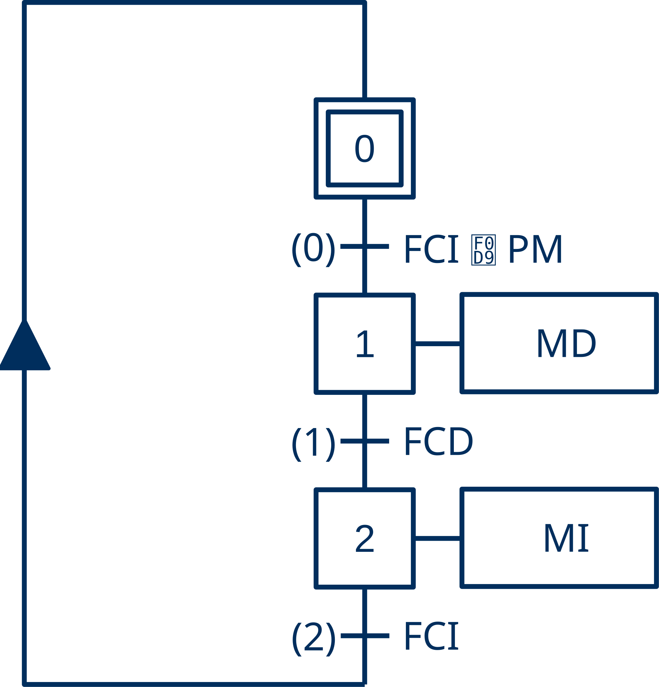
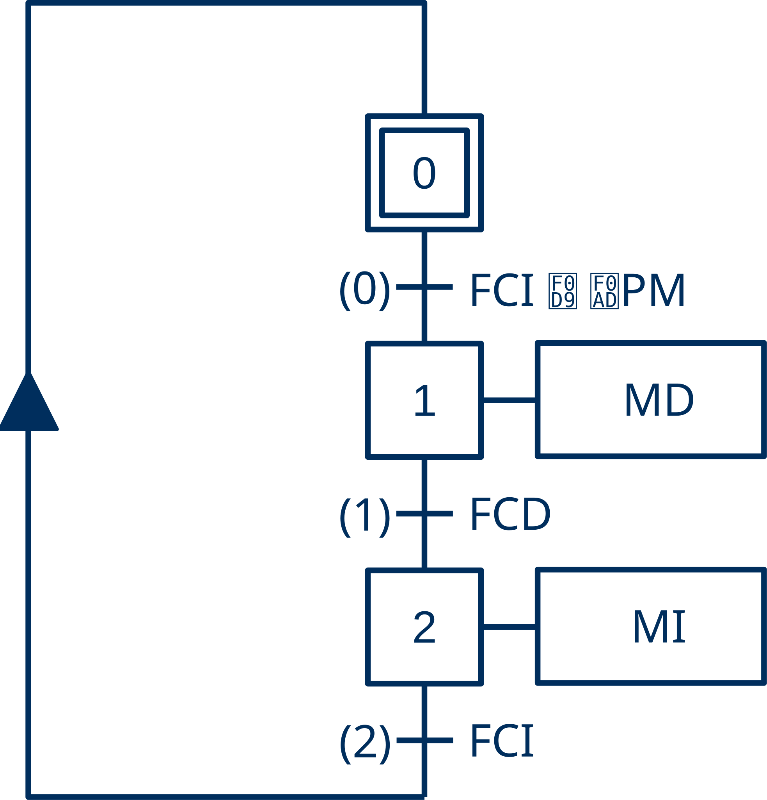
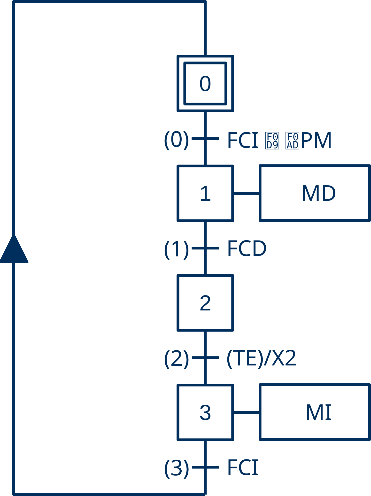
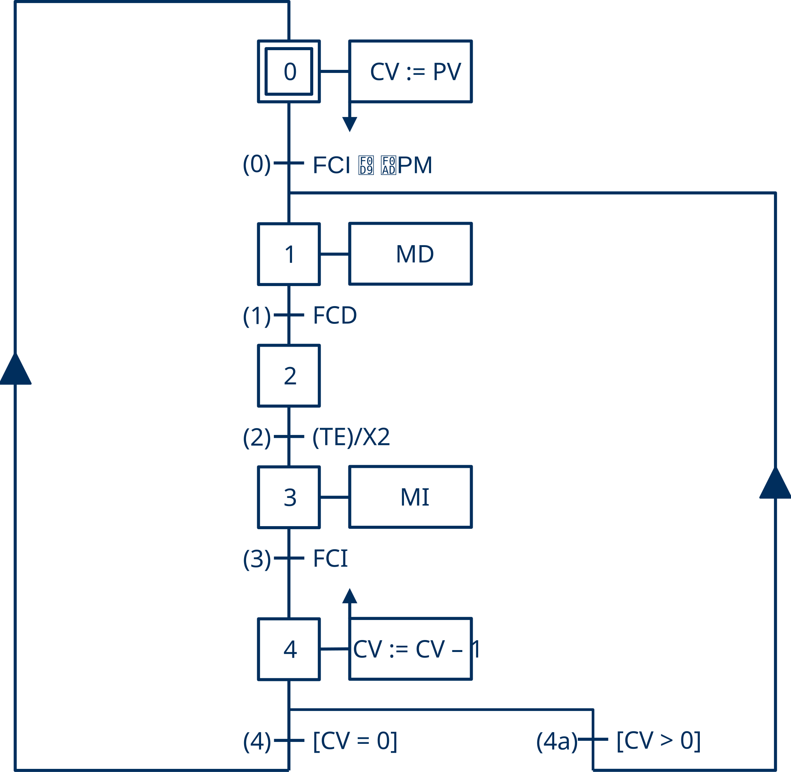
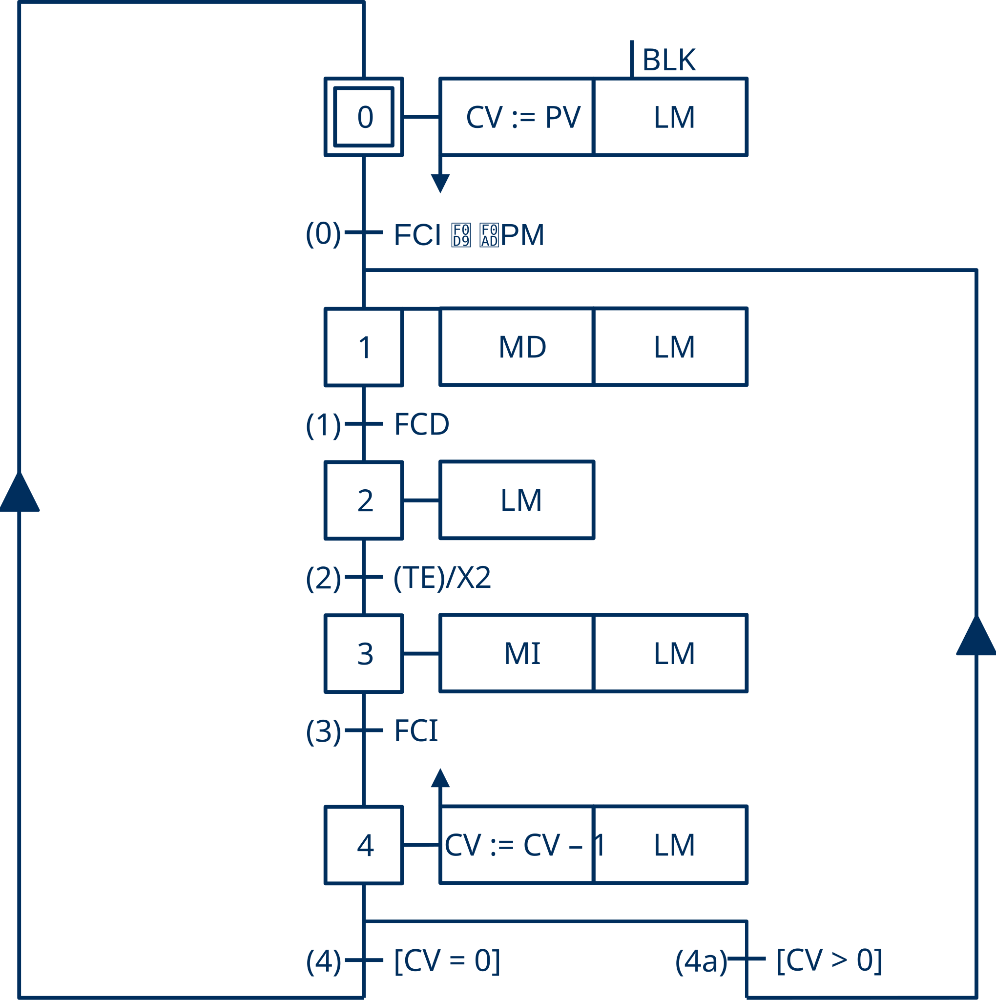

# :fontawesome-solid-screwdriver-wrench: Carro Básico - Guía de Implementación

## :fontawesome-solid-circle-info: Introducción

Las **máquinas de estados** que representan el comportamiento (lógica de control) de un automatismo industrial pueden representarse utilizando diversos «lenguajes» de especificación, tradicionales como los **diagramas de relés y contactos** o más actuales como el lenguaje **GRAFCET**.

El comportamiento especificado en estos diagramas, finalmente debe codificarse en un determinado lenguaje de programación para ser procesado por un PLC.

En esta guía se muestra cómo replicar paso a paso el ejemplo [**«Carro Básico»**](../carro-basico/index.md) en todas sus modalidades (básico, pulsado, temporizado, limitado y señalizado).

## :fontawesome-solid-bullseye: Objetivos

A lo largo de este proceso aprenderás a:

- Especificar una **máquina de estados** con el lenguaje **GRAFCET**.
- Especificar una **máquina de estados** con **diagramas de relés y contactos**.
- Implementar un **GRAFCET**, utilizando los lenguajes {{SFC}}, {{ST}} y {{LD}} de la norma **IEC 61131-3**.
- Implementar un **diagrama de relés y contactos** utilizando el lenguaje {{LD}} de la norma **IEC 61131-3**.
- Utilizar los elementos básicos presentes en casi cualquier automatismo industrial: **detección de flancos**, **evaluación de lapsos de tiempo**, **contaje de eventos** e **intermitencias**.

---

## :fontawesome-solid-list-check: Especificación con GRAFCET

### Carro Básico

Empieza especificando en el lenguaje GRAFCET la máquina de estados correspondiente al carro básico.
<!--- todo: cómo se construye un grafcet --->

> El carro básico se desplaza longitudinalmente entre los extremos de una vía.

{ width="200px" .image-centered }
!!! note "Comentarios"
    - Inicialmente el carro se encuentra detenido a la izquierda.
    - Cuando se acciona el pulsador, se pone en marcha hacia la derecha.
    - Cuando alcanza el extremo derecho, invierte el sentido de la marcha.
    - Cuando alcanza el extremo izquierdo, se detiene.

??? info "Tabla de Variables"
    | Etiqueta | Origen | Tipo | Variable | Descripción |
    | :---: | :---: | :---: | :--- | :--- |
    | PM | Entrada | Binaria | `i_PulsadorMarcha` | Pulsador de Marcha |
    | FCI | Entrada | Binaria | `i_FinalCarreraIzquierda` | Final de carrera izquierda |
    | FCD | Entrada | Binaria | `i_FinalCarreraDerecha` | Final de carrera derecha |
    | MD | Salida | Binaria | `o_MarchaDerecha` | Marcha Derecha |
    | MI | Salida | Binaria | `o_MarchaIzquierda` | Marcha Izquierda |

??? warning "Nomenclatura"
    - Por conveniencia, en el diagrama *grafcet* se utilizan nombres cortos (etiquetas).
    - Sin embargo, para obtener un código limpio los identificadores de las variables tienen una carga semántica clara que revela su propósito sin necesidad de comentario adicional.

### Carro Pulsado

> El carro pulsado inicia su viaje de ida y vuelta, únicamente, cuando estando en su posición inicial se acciona el pulsador de marcha.

{ width="200px" .image-centered }
!!! note "Comentarios"
    - El símbolo `↑` representa, en el lenguaje **GRAFCET**, el flanco ascendente de una variable lógica.

### Carro Temporizado

> El carro temporizado se detiene durante un instante ($T_{espera}$) sobre el final de carrera derecho antes de iniciar el regreso a su posición inicial.

{ width="200px" .image-centered }
!!! note "Comentarios"
    - La expresión `(TE)/X2` es el símbolo **GRAFCET** (condición de transición dependiente del tiempo simplificada) utilizado para indicar que se esperará en la etapa `2` la cantidad de tiempo indicada por la variable `TE`.
    - El término `X2` es la variable asociada a la etapa 2 que indica su estado de actividad (`X2` es `TRUE` si la etapa 2 está activada).

### Carro Limitado

> El carro limitado realiza un determinado número de viajes consecutivos de ida y vuelta (tarea) cada vez que, estando en su posición inicial, se acciona el pulsador de marcha.

??? info "Procesamiento por Lotes"
    Con el carro limitado se introduce el concepto de **procesamiento por lotes**. Cuando se trabaja por lotes el sistema hace una tarea por cada activación del pulsador de marcha sin intervención del operario, por lo que es necesario llevar la cuenta de los viajes (maniobras) que realiza el carro.

{ width="400px" .image-centered }
!!! note "Comentarios"

    Para llevar la cuenta de las maniobras (viajes) pendientes en **GRAFCET** se acostumbra a distribuir esta funcionalidad entre la estructura y la interpretación.

    - En la **estructura** se introduce una nueva etapa (`4`) y una rama alternativa (`4a`) para evaluar si la tarea ha terminado.
    - En la **interpretación** se incluyen dos acciones memorizadas, una asociada a la activación de la etapa inicial (`S0`) para reiniciar el contador de viajes pendientes y otra asociada a la entrada de la etapa final (`S4`) para actualizar el contador con cada maniobra finalizada.

??? info "Contadores"
    Por razones históricas, en automatización se suele utilizar **cuentas regresivas**. En los antiguos sistemas electromecánicos y de electrónica discreta, comprobar si un contador había finalizado su tarea era drásticamente más simple y económico si se comparaba con el **cero absoluto**. Esta comparación requiere únicamente un contacto físico o una sola compuerta lógica (`NOR`), independientemente del valor de la cuenta.
    Esta lógica de diseño se hereda para optimizar el rendimiento en los procesadores de PLC modernos, que activan un indicador de estado (*Zero Flag*) al alcanzar el cero. Así se evitan instrucciones de comparación adicionales y se ofrece un control intrínsecamente más seguro ante desbordamientos.

### Carro Señalizado

> La lámpara de marcha se enciende de forma permanente para indicar que el carro está en funcionamiento y parpadea para indicar que el carro está en reposo.

{ width="400px" .image-centered }
!!! note "Comentarios"

    - La señal de salida `LM` se activa de forma intermitente mediante una **acción condicionada** a la señal oscilante `BLK`.
    - La señal de salida `LM` se activa mediante una **acción continua** para que permanezca fija en el resto de las etapas.

---

## :fontawesome-solid-list-check: Guía de Implementación

!!! tip "Sugerencia"
    Pulsa en :material-arrow-right-bold-box: para obtener más información sobre cómo realizar el paso especificado.

--8<-- "docs/contenidos/ejemplos/carro-basico/includes/grafcet-a-sfc.md"

---

--8<-- "docs/contenidos/ejemplos/carro-basico/includes/grafcet-a-st.md"

---

--8<-- "docs/contenidos/ejemplos/carro-basico/includes/grafcet-a-ld.md"

---
