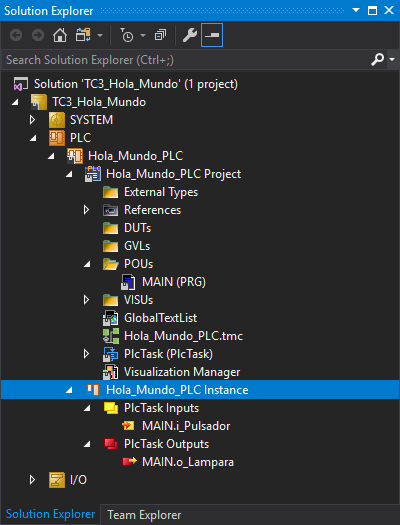

### Sobre un Controlador

Si dispones de un controlador de Beckhoff (ordenador embebido), puedes probar el proyecto con entradas y salidas reales conectadas a sus terminales.

??? warning "Material Necesario"
    Para probar el programa con un pulsador y una lámpara real es necesario:

    - Disponer de un controlador Beckhoff en condiciones de funcionamiento.
    - Disponer de un pulsador conectado a un canal de entrada.
    - Disponer de una lámpara conectada a un canal de salida.
    - Modificar y reconstruir nuevamente el programa.
    - Configurar la E/S: escanear, identificar y vincular canales de E/S.

1. Desconéctate (**Logout**), si estabas conectado, del sistema destino actual.
2. Utiliza <span class="objetivo-hito">variables de entrada/salida localizadas con mapeo dinámico</span> para situar las variables `i_Pulsador` y `o_Lampara` en la imagen de entrada y salida, modificando su declaración tal y como se muestra a continuación. [:material-arrow-right-bold-box:](../../fundamentos/lenguajes/index.md#variables-localizadas-y-mapeo-dinamico)

    ```iecst {hl_lines="6-7"}
    // Hola Mundo de la Programación de PLC
    PROGRAM MAIN
    VAR
        ContadorCiclos: UINT;

        i_Pulsador AT %I*: BOOL;
        o_Lampara AT %Q*: BOOL;
    END_VAR
    ```

3. Genera las instancias de las variables de entrada y salida, construyendo (**Build**) nuevamente el proyecto.

    !!! success "Resultado de la operación"
        { .screenshot }

    ??? note "Instancias de E/S"
        Si la compilación es correcta aparecen bajo el apartado `Hola_Mundo_PLC Instance` las instancias de las dos nuevas variables `i_Pulsador` y `o_Lampara`.

        ```text
            Hola_Mundo_PLC Instance/
            ├── PLCTask Inputs
            |   └── MAIN.i_Pulsador
            └── PLCTask Outputs
                └── MAIN.o_Lampara
        ```

4. Encuentra el nuevo sistema destino (**controlador remoto**) de Beckhoff presente en la red local, creando una ruta de acceso. [:material-arrow-right-bold-box:](../../procedimientos/workflow/index.md#crear-una-ruta)
5. Selecciona el **controlador remoto** como nuevo sistema destino. [:material-arrow-right-bold-box:](../../procedimientos/workflow/index.md#seleccionar-sistema-destino)
6. Empieza la <span class="objetivo-hito">configuración de la entrada/salida</span> escaneando (**Scan**) la entrada/salida (**I/O**) en busca de dispositivos y terminales. [:material-arrow-right-bold-box:](../../procedimientos/workflow/index.md#buscar-dispositivos)

    ??? tip "Sugerencias"
        - Busca en la lista de entradas y salidas de la **descripción funcional** del sistema una señal de entrada (preferiblemente un **pulsador**) y otra de salida (preferiblemente una **lámpara**).
        - **Desactiva** los dispositivos de entrada y salida que no se van a utilizar (todos menos el dispositivo denominado `EtherCAT`).

7. Localiza, identifica, nombra y prueba un canal de entrada digital para `i_Pulsador`. [:material-arrow-right-bold-box:](../../procedimientos/workflow/index.md#identificar-entradas)
8. Localiza, identifica, nombra y prueba un canal de salida digital para `o_Lampara`. [:material-arrow-right-bold-box:](../../procedimientos/workflow/index.md#identificar-salidas)
9.  <span class="objetivo-hito">Vincula las variables de entrada/salida</span> (**Link**) `i_Pulsador` y `o_Lampara` con los canales recién identificados. [:material-arrow-right-bold-box:](../../procedimientos/workflow/index.md#vincular-variables)
10. Activa la configuración (**Activate Configuration**) y reinicia TwinCAT (**Restart TwinCAT System**) en el nuevo sistema destino. [:material-arrow-right-bold-box:](../../procedimientos/workflow/index.md#activar-la-configuracion)
11. Transfiere el programa al controlador (**Login**). [:material-arrow-right-bold-box:](../../procedimientos/workflow/index.md#transferir-el-proyecto)
12. Inicia la ejecución del programa (**Start**). [:material-arrow-right-bold-box:](../../procedimientos/workflow/index.md#arrancar-el-proyecto)
13. Comprueba.
    - El contador de ciclos sigue incrementándose de forma continua.
    - Al accionar el pulsador físico se enciende la lámpara física.
14. Utiliza la visualización integrada en el proyecto PLC para facilitar la prueba.
    - Comprueba que, accionando el pulsador físico, cambia de estado la lámpara en la visualización.
    - Comprueba que, accionando el botón de la visualización, **NO cambia de estado la lámpara**.

    ??? note "Aclaración"
        Que ahora el botón de la visualización **«NO FUNCIONE»** no es un mal funcionamiento, es la consecuencia lógica de la ejecución del ciclo de *scan* que provoca que, el valor de la variable `i_Pulsador` **se actualice con el valor del pulsador físico** al inicio de cada ciclo de ejecución del programa de PLC, sobreescribiendo el valor que fija el botón de la visualización.

!!! success ":fontawesome-solid-trophy: ¡Enhorabuena!"
    Has completado con éxito la segunda parte de esta guía.

    Has puesto en marcha tu primer **proyecto de PLC** completo en **Texto Estructurado** con **TwinCAT 3** sobre un **controlador** real.

??? tip "Recomendación"
    - Para ejecutar el proyecto sobre un controlador real con terminales de E/S asociados es necesario antes de activar la configuración tener HABILITADOS los dispositivos de E/S que se vayan a utilizar.
    - Para ejecutar el proyecto sobre un runtime sin terminales de E/S asociados (como el simulador `UmRT_Default`) es necesario antes de activar la configuración tener DESHABILITADOS los dispositivos de E/S ya que no se van a utilizar.
    - Para conmutar la habilitación, expande **I/O** > **Devices**, haz clic derecho en :material-mouse-right-click: el dispositivo y selecciona lo que corresponda (**Enable**/**Disable**).
