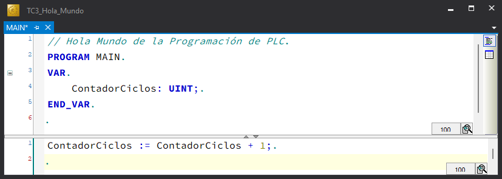
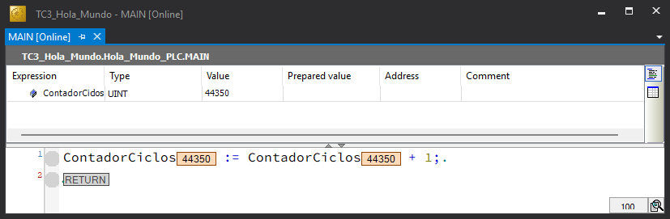
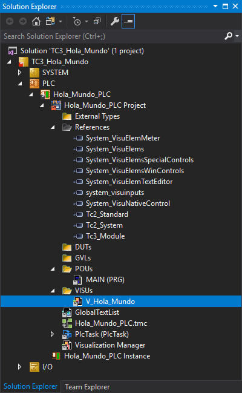
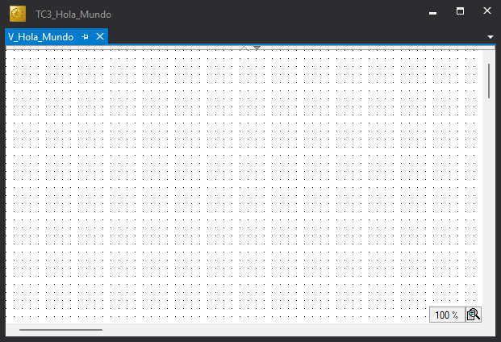

### Sobre el Simulador

Empiecemos por <span class="objetivo-hito">utilizar el entorno de ingeniería TwinCAT XAE de TwinCAT 3</span> para crear nuestro primer proyecto.
[:material-arrow-right-bold-box:](../../fundamentos/twincat/index.md#twincat-xae)

??? info "TwinCAT 3"
    - Para instalar TwinCAT 3. [:material-arrow-right-bold-box:](../../fundamentos/twincat/index.md#guia-de-instalacion)
    - Si ya tienes instalado TwinCAT 3 en tu ordenador, aunque no tengas ningún controlador Beckhoff, puedes implementar el proyecto completo (código y visualización) y ejecutarlo en el simulador `UmRT_Default`. [:material-arrow-right-bold-box:](../../fundamentos/twincat/index.md#umrt_default)

1. Abre la aplicación **TwinCAT XAE**. [:material-arrow-right-bold-box:](../../procedimientos/workflow/index.md#abrir-twincat-xae)
2. Crea una solución de TwinCAT 3 con nombre `TC3_Hola_Mundo`. [:material-arrow-right-bold-box:](../../procedimientos/workflow/index.md#crear-un-proyecto-twincat-3)
3. Oculta las configuraciones innecesarias para dejar el Explorador de la Solución lo más despejado posible. [:material-arrow-right-bold-box:](../../procedimientos/workflow/index.md#ocultar-configuraciones)
4. Crea un proyecto PLC estándar con el nombre `Hola_Mundo_PLC`. [:material-arrow-right-bold-box:](../../procedimientos/workflow/index.md#crear-un-proyecto-plc)

5. En el panel del Explorador de la Solución haz clic sobre el programa `MAIN`, que se encuentra en **TC3_Hola_Mundo** > **PLC** > **Hola_mundo_PLC** > **POUs**, se abrirár la ventana de edición y podrás incluir un **comentario de línea** inicial sobre el **encabezado del POU** utilizando `//`.

    ```iecst {hl_lines="1"}
    // Hola Mundo de la Programación de PLC
    PROGRAM MAIN
    VAR
    END_VAR
    ```

    ??? warning "Nota Didáctica"
        Téngase en cuenta que, para facilitar la comprensión y exclusivamente con fines pedagógicos, en este primer ejemplo todo el código se implementa directamente dentro del **programa** principal (`MAIN`).

        La buena práctica en programación industrial dicta que el `MAIN` debe actuar únicamente como punto de entrada y organizador del proyecto, mientras que la lógica de control debe residir en otras **Unidades de Organización del Programa** (`POUs`) —fundamentalmente **Bloques de Función** (`FB`)— que permiten modularizar, escalar y replicar fácilmente los comportamientos y las funcionalidades del sistema.

6. <span class="objetivo-hito">Declara la variable local de memoria interna</span> `ContadorCiclos` como un entero sin signo (`UINT`) en el bloque `VAR` de la parte de declaración del programa `MAIN`. [:material-arrow-right-bold-box:](../../procedimientos/workflow/index.md#declarar-una-variable)

    ```iecst {hl_lines="4"}
    // Hola Mundo de la Programación de PLC
    PROGRAM MAIN
    VAR
        ContadorCiclos: UINT;
    END_VAR
    ```

    ??? info "Tipo UINT"
        Según el estándar **IEC 61131-3**, el tipo de dato `UINT` representa un entero sin signo de 16 bits (0 a 65535).

7. <span class="objetivo-hito">Edita un sencillo fragmento de código en el lenguaje Texto Estructurado (ST)</span> para la gestión del contador de ciclos en la parte de implementación del programa `MAIN`, utilizando el operador de asignación (`:=`).

    ```iecst
    ContadorCiclos := ContadorCiclos + 1;
    ```

    !!! success "Resultado de la operación"
        { .screenshot }

8. Guarda el proyecto [:material-arrow-right-bold-box:](../../procedimientos/workflow/index.md#guardar)
9. <span class="objetivo-hito">Construye el proyecto</span> para obtener un archivo ejecutable. [:material-arrow-right-bold-box:](../../procedimientos/workflow/index.md#construir-el-proyecto)

    ??? warning "Error List"
        Asegúrate, antes de continuar, de que el resultado de la construcción del proyecto mostrado en la ventana de mensajes **Error List** no arroja errores.

10. Activa el simulador `UmRT_Default` para disponer de un *runtime* sobre el que ejecutar el código del proyecto. [:material-arrow-right-bold-box:](../../procedimientos/workflow/index.md#activar-simulador)
11. <span class="objetivo-hito">Selecciona como sistema destino</span> (**Target System**) el simulador `UmRT_Default`. [:material-arrow-right-bold-box:](../../procedimientos/workflow/index.md#seleccionar-sistema-destino)
12. Activa la configuración en el sistema destino. [:material-arrow-right-bold-box:](../../procedimientos/workflow/index.md#activar-la-configuracion)
13. Activa la licencia temporal del *runtime* del sistema destino si es necesario. [:material-arrow-right-bold-box:](../../procedimientos/workflow/index.md#activar-licencia)
14. <span class="objetivo-hito">Transfiere el proyecto</span> conectándote (**Login**) al sistema destino. [:material-arrow-right-bold-box:](../../procedimientos/workflow/index.md#transferir-el-proyecto)
15. <span class="objetivo-hito">Pon el programa en ejecución</span> (**Run**). [:material-arrow-right-bold-box:](../../procedimientos/workflow/index.md#arrancar-el-proyecto)

    !!! success "Resultado de la operación"
        { .screenshot }

16. Observa cómo el valor de la variable `ContadorCiclos` se incrementa continuamente al ritmo de ejecución del ciclo básico del PLC (típicamente 10 ms), lo que prueba que el programa se está ejecutando localmente en el *runtime* del simulador `UmRT_Default` en tu ordenador.
17. Modifica el valor del contador de ciclos mediante forzado de variables (**Force values**, **Unforce values**, **Write values**). [:material-arrow-right-bold-box:](../../procedimientos/workflow/index.md#forzar-variables)
18. Desconéctate del sistema destino (**Logout**) para continuar con la edición del programa. [:material-arrow-right-bold-box:](../../procedimientos/workflow/index.md#desconectar)

    ??? info "Logout"
        Cuando te desconectas de un sistema destino abandonas la monitorización, pero el programa sigue ejecutándose en su *runtime*. Como prueba, observarás que, cuando vuelvas a conectarte, el contador de ciclos tendrá un valor diferente.

19. Para <span class="objetivo-hito">monitorizar y modificar el valor del dato numérico</span> del contador de ciclos, crea una sencilla visualización (`V_Hola_Mundo`). [:material-arrow-right-bold-box:](../../procedimientos/hmi/includes/tc3-plc-hmi.md)

    !!! success "Resultado de la operación"
        - Tras crear la visualización podremos observar como en el Explorador de la Solución se han incluido la visualización en el nodo en `VISUs` y las librerías para la gestión de la visualizaicón en el nodo `References`...

        { .screenshot }

        - ... y, además, se muestra la ventana de la visualización con el lienzo vacío sobre el que se dispondrán los diferentes objetos gráficos.

        { .screenshot }

20. Agregar los objetos gráficos necesarios. [:material-arrow-right-bold-box:](../../procedimientos/hmi/includes/tc3-plc-hmi.md#agregar-un-objeto)

    1. Un rectángulo (*Rectangle*) para la **etiqueta** «Contador». [:material-arrow-right-bold-box:](../../procedimientos/hmi/includes/tc3-plc-hmi.md#rentangulos)

        ??? note "Parámetros"
            - **Position** ➔ [30, 80, 90, 30, 0]
            - **Colors** > **Normal state** > **Frame color** ➔ [0, 0, 0]
            - **Colors** > **Normal state** > **Fill color** ➔ [0, 0, 0]
            - **Texts** > **Text** ➔ [Contador]
            - **Text properties** > **Font** ➔ [Arial, Negrita, 12]
            - **Text properties** > **Font Color** ➔ Blanco = [255, 255, 255]

    2. Un rectángulo (*Rectangle*) para **mostrar el valor** de la variable `ContadorCiclos`.

        ??? note "Parámetros"
            - **Position** ➔ [130, 80, 90, 30, 0]
            - **Colors** > **Normal state** > **Frame color** ➔ [0, 0, 0]
            - **Colors** > **Normal state** > **Fill color** ➔ [192, 192, 192]
            - **Texts** > **Text** ➔ [%d]
                - *Formato estilo printf que, en este caso, indica que el dato a mostrar se formateará como un número entero (`%d`).*
            - **Text variables** > **Text variable** ➔ [`MAIN.ContadorCiclos`]

    3. Un rectángulo (*Rectangle*) para **modificar el valor** de la variable `ContadorCiclos`.

        ??? note "Parámetros"
            - **Position** ➔ [230, 80, 90, 30, 0]
            - **Colors** > **Normal state** > **Frame color** ➔ [0, 0, 0]
            - **Colors** > **Normal state** > **Fill color** ➔ [255, 255, 255]
            - **Texts** > **Text** ➔ [%d]
            - **Text variables** > **Text variable** ➔ [`MAIN.ContadorCiclos`]
            - **Inputconfiguration** > **OnMouseClick**

    4. Un botón (*Button*) para **reiniciar el valor** de la variable `ContadorCiclos`.

        ??? note "Parámetros"
            - **Position** ➔ [330, 80, 90, 30]
            - **Texts** > **Text** ➔ [**Reinicia**]
            - **Inputconfiguration**
                - **OnMouseClick** > **Configure** > **Execute ST-Code** ➔ [`MAIN.ContadorCiclos := 0;`]

    !!! success "Resultado de la operación"

        { .screenshot }


    ??? tip "Sugerencia"
        Las posiciones, tamaños y colores asignados a estos elementos son meramente ilustrativos.

21. Vuelve a conectarte (**Login**) y comprueba que todos los elementos de la visualización funcionan correctamente.
22. Vuelve a desconectarte (**Logout**) e incluye en la parte de declaración del programa `MAIN` las variables `i_Pulsador` y `o_Lampara`.

    ```iecst {hl_lines="6-7"}
    // Hola Mundo de la Programación de PLC
    PROGRAM MAIN
    VAR
        ContadorCiclos: UINT;

        i_Pulsador: BOOL;
        o_Lampara: BOOL;
    END_VAR
    ```

23. Incluye el código correspondiente a la activación de la lámpara en la parte de implementación del programa `MAIN`.

    ```iecst {hl_lines="2"}
    ContadorCiclos := ContadorCiclos + 1;
    o_Lampara := i_Pulsador;
    ```

24. Incluye en la **visualización** los elementos correspondientes para <span class="objetivo-hito">monitorizar y modificar los valores de las variables booleanas</span> correspondientes al pulsador y a la lámpara.

    { .screenshot }

    1. Botón (*Button*) para modificar el valor de `i_Pulsador`.

        ??? note "Parámetros"
            - **Texts** > **Text** ➔ [**Pulsador**]
            - **Inputconfiguration**
                - **Tap** > **Variable** ➔ [`MAIN.i_Pulsador`]

    2. Rectángulo (*Rectangle*) para mostrar el valor de la variable `o_Lampara`.

        ??? note "Parámetros"
            - **Colors** > **Normal state** > **Frame color** ➔ [0, 64, 0]
            - **Colors** > **Normal state** > **Fill color** ➔ [0, 64, 0]
            - **Colors** > **Alarm state** > **Frame color** ➔ [0, 128, 0]
            - **Colors** > **Alarm state** > **Fill color** ➔ [0, 128, 0]
            - **Texts** > **Text** ➔ [**Lámpara**]
            - **Color variables** > **Toggle color** ➔ [`MAIN.o_Lampara`]

    !!! tip "Sugerencia"
        Completa la visualización con los elementos que consideres oportunos para mejorar su apariencia.

25. Conéctate nuevamente (**Login**) para <span class="objetivo-hito">validar el proyecto</span> desde la visualización.

    ??? warning "Compilación Implícita"
        Si, tras modificar el programa de PLC, intentas conectarte (**Login**) al *runtime* sin compilar previamente, TwinCAT compilará por ti.

        La transferencia del nuevo código queda supeditada a que el resultado de la compilación sea exitoso.

!!! success ":fontawesome-solid-trophy: ¡Enhorabuena!"
    Has completado con éxito la primera parte de esta guía de implementación.

    Has puesto en marcha tu primer **proyecto de PLC** completo en **Texto Estructurado** con **TwinCAT 3** sobre el simulador **UmRT_Default**.
