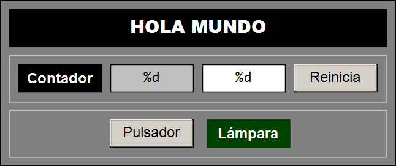
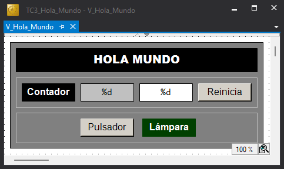

# :fontawesome-solid-hand: Hola Mundo

## :fontawesome-solid-file-lines: Descripción

Este proyecto es el **«Hola Mundo»** de la programación de **autómatas programables (PLC)**.

El proyecto **Hola Mundo** se ha desarrollado con el entorno **TwinCAT 3** empleando el lenguaje **Texto Estructurado (ST)** conforme a la norma **IEC 61131-3**.

**Hola Mundo** es un proyecto mínimo y funcional, que muestra la declaración y el uso básico de variables booleanas y enteras, ubicadas en los espacios de memoria de marcas, imagen de entrada e imagen de salida. Cubriendo los elementos esenciales de programación del lenguaje {{ST}} de la norma **IEC 61131-3** para la programación de PLC.

{ .screenshot }
<figcaption>Figura 1: Visualización del proyecto Hola Mundo.</figcaption>

Este proyecto incluye además, una **visualización** elemental que permite, mediante objetos gráficos, interactuar con las variables del proyecto. Utilizando **formas rectangulares**, para mostrar el valor de variables booleanas y numéricas, y **botones** para modificar sus valores.

!!! important "Objetivo Principal del Proyecto"
    El valor fundamental de este ejemplo radica en que, con muy pocos elementos, ilustra el **flujo de trabajo completo** (*workflow*) requerido para crear, configurar y desplegar un proyecto en **TwinCAT 3**.

---

## :fontawesome-solid-folder-tree: Estructura (Simplificada) del Proyecto

```text
TC3_Hola_Mundo/
├── TC3_Hola_Mundo.sln              <-- Solución de Visual Studio
└── TC3_Hola_Mundo/                 <-- Proyecto TwinCAT
    └── Hola_Mundo_PLC/             <-- Proyecto PLC
        ├── POUs/
        │   └── MAIN.TcPOU          <-- Programa principal (Código ST)
        └── VISUs/
            └── V_Hola_Mundo.TcVISU <-- Visualización (Interfaz gráfica)
```

---

## :fontawesome-solid-code: Código

### Parte de Declaración

```iecst
// Hola Mundo de la Programación de PLC
PROGRAM MAIN
VAR
    ContadorCiclos: UINT;
    i_Pulsador AT %I*: BOOL;
    o_Lampara AT %Q*: BOOL;
END_VAR
```

!!! note "Comentarios"
    - La interfaz del programa `MAIN` (cabecera y definición de variables) se define en la **Parte de Declaración**.
    - Los **comentarios** de una línea empiezan con `//`.
    - La variable `ContadorCiclos` se declara como un entero sin signo (`UINT`).
    - La variable `i_Pulsador` se declara como un ***booleano*** (`BOOL`) y se localiza dinámicamente en la **Imagen de Entrada** (`AT %I*`).
    - La variable `o_Lampara` se declara como un ***booleano*** (`BOOL`) y se localiza dinámicamente en la **Imagen de Salida** (`AT %Q*`).

---

### Parte de Implementación

```iecst
ContadorCiclos := ContadorCiclos + 1;
o_Lampara := i_Pulsador;
```

!!! note "Comentarios"
    - El código del módulo, en lenguaje {{ST}}, se incluyue en la **Parte de Implementación**.
    - La variable `ContadorCiclos` se incrementa indefinidamente una vez por **Ciclo Básico** de ejecución del **PLC** (10 ms).
    - La variable de salida `o_Lampara` copia, continuamente, el valor de la variable de entrada `i_Pulsador`.

---

### Visualización

{ .screenshot }

!!! note "Comnentarios"
    - El valor de la variable `ContadorCiclos` se muestra en rectángulo gris la visualización.
    - El valor de la variable `ContadorCiclos` se se puede cambiar escribiéndolo en rectángulo blanco la visualización.
    - La variable `ContadorCiclos` puede reiniciarse accionando el pulsador `Reinicia`.
    - El valor de la variable `o_Lampara` se muestra con el cambio de color del rectángulo `Lampara` (verde claro ➔ `FALSE`, verde oscuro ➔ `TRUE`).
    - El valor de la variable `i_Pulsador` cambia cuando se acciona el botón `Pulsador`.

---

## :fontawesome-solid-screwdriver-wrench: Implementación

!!! info "Guía de implementación"
    Para implementar  este proyecto desde cero en TwinCAT 3, seguir la **[Guía de implementación](step-by-step.md)**.

---

## :fontawesome-solid-download: Código Fuente y Descarga

El código fuente completo de este proyecto **Hola Mundo** está disponible en GitHub:

- :simple-github: **Repositorio:** [:material-link-variant: vetorres-uma/TC3_Hola_Mundo](https://github.com/vetorres-uma/TC3_Hola_Mundo)
- :simple-github: **Descargar:** [:material-download: Archivo fuente `.zip`](https://github.com/vetorres-uma/TC3_Hola_Mundo/archive/refs/heads/main.zip)

Los miembros de la **Universidad de Málaga**, también pueden descargarse el archivo comprimido de la solución (tnzip) del proyecto desde el siguiente repositorio:

- :simple-googledrive: **Descargar:** [:material-download: Solución comprimida `.tnzip`](https://drive.google.com/file/d/1HiN3VGmpYH63-8s_RbQovNkcL4GJR9_5/view?usp=drive_link)

---
